# Perennial

**One tree is shade in summer, food in fall and fire in winter.**

A Four Seasons game for the ThunderHacks 2026 Algoma Game Jam.

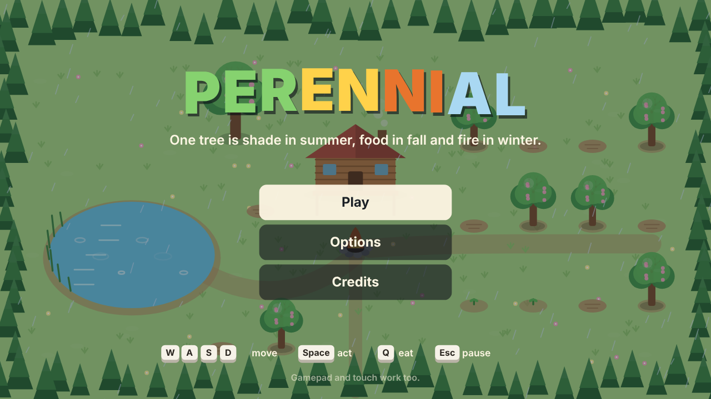

## Play it now

**[▶ Play Perennial in your browser](https://aryano96.github.io/Algoma-Game-Jam/)**: this is served by GitHub Pages from the latest `index.html` in this repo, with nothing to install. It works on a laptop with a keyboard or gamepad, and on a phone or tablet with the touch controls.

Backup links: [raw.githack copy](https://raw.githack.com/aryano96/Algoma-Game-Jam/main/index.html) and [hosted copy on Claude](https://claude.ai/artifact/FnPmHve9MJkY951WdRUGky).

Found a bug or have an idea? Open an issue on this repo.

## Run it

Open `index.html` in any modern browser (Chrome, Edge, Firefox, Safari). That is the whole game: one file, no install, no server, no internet connection needed. Click the window once if the keyboard doesn't respond.

For the judging table: open it full screen (F11), keep the volume up, and let the judge press **Enter**.

## How to play

| Key (remappable) | Does |
|---|---|
| WASD or arrow keys | Move |
| Space or E | Act: plant, fill bucket, water, chop, feed the fire |
| Q or F | Eat a fruit (heals) |
| Esc or P | Pause (the pause screen explains every season in pictures) |

Gamepad (stick or d-pad, A act, X eat, Start pause) and touch (drag to move, buttons on the right) also work.

Walk over seeds, fruit and wood to pick them up. Survive **3 winters** to win; after that you can keep going in endless mode. Your score is counted in tree rings.

## The four seasons change the rules

| Season | What changes | Your job | Danger |
|---|---|---|---|
| **Spring** (rain) | Soil is soft. Seeds can only be planted now. The pond is full. | Plant seeds in the soil plots. | Rabbits come to eat your sprouts. Chase them off. |
| **Summer** (heat) | Summer lasts 10 seconds longer than the other seasons. The sun hurts you outside of shade. The pond shrinks. Sprouts dry out. | Carry water from the pond to your sprouts. Rest in tree shade or on the porch. | Heat stroke. Sprouts that dry out wither. |
| **Fall** (wind) | Sprouts that survived become trees. Trees drop fruit, seeds and branches. Wind pushes you and blows loose fruit away; fruit blown into the pond or off the map is lost. | Gather fruit (basket holds 6) and wood (arms hold 6). Collect seeds for next spring. Stock the fire. | Fruit left on the ground rots when winter comes. |
| **Winter** (snow, night) | It's dark and you move slowly through snow. The fire burns fuel fast. Hunger is sharp. The pond freezes over (slippery). | Keep the hearth burning. Eat. Venture into the dark for deadwood, or chop one of your own trees. | Cold away from the fire light. Wolves in the dark. Standing on the ice when spring thaws drops you in. |

### The stray dog

A few seconds into summer, a stray dog wanders into the meadow. Walk up to it and press the act key to adopt it. A dashed outline then appears beside the cabin: drop **4 wood** there to build the dog a house. That wood is the same wood you need for the winter fire.

Once adopted, the dog helps you in every season:

- **Spring:** it chases rabbits away from your sprouts.
- **Summer:** now and then it digs up a stick.
- **Fall:** it fetches fruit from anywhere on the map, but only while your basket has room.
- **Winter:** with a house, it walks with you into the dark and barks wolves away. Without a house, it shivers by the fire and can't help, and a small bubble over it shows that it needs a house.

The dog and the rabbits walk around the pond, never through it. A rabbit going after your sprouts shows a red **!!** bubble.

Once it has a house, the dog goes home when you do: whenever you're on the porch or by the fire, it trots over and naps in front of its house (unless it's busy chasing a rabbit or fetching fruit). Walk away and it gets up and follows you again.

If you don't adopt it by the end of summer, it leaves, and it comes back next summer. Press the act key beside your dog when there's nothing else to do, and you'll pet it.

### The porch cat

At the start of year 2, a white cat wanders in, hops up onto the red porch beam of the cabin and lies stretched out along it for the rest of the game. Its tail hangs over the edge and swings lazily. Now and then it opens its yellow eyes for a look around, then dozes off again. It wears a little red scarf in winter. Stand beside it and press the act key to pet it: it purrs and a **yellow heart** pops up. Petting the dog pops a **red heart**.

### The sun jar: carry summer into winter

You start with an empty glass jar, shown at the right end of your item bar.

- **Summer:** stand out in the sun and the jar fills over 8 seconds. A small jar above your head shows it filling. You're out of the shade the whole time, so the heat costs you health. Stepping into shade pauses it.
- **Fall:** the full jar glows in your item bar and keeps until you use it. You hold one jar.
- **Winter:** away from the fire, press the act key to open it. For 10 seconds a circle of summer moves with you: you stay warm, the dark lifts, and the snow melts under your feet so you walk at full speed. It doesn't stop wolves; that's the dog's job.

Then the jar is empty until next summer. It turns the season itself into something you can store and spend, and it makes a long trip into the dark for wood possible.

### Tree memories

Each tree remembers the year you planted it. Stand close and you'll see it carved in the bark, like `Y1`. Chopped or burnt trees leave a stump with one ring for every year the tree lived. When a tree falls, a ghost of it in full summer leaf, with its shade, flashes over the stump for a moment, labelled with its year and rings. You see what you gave up.

### Weather events in summer, fall and winter

A red dot on the season wheel shows when the event will hit. A red **!!** warning appears 3 seconds before it starts, with a countdown and an alarm.

| Season | Event | What you do |
|---|---|---|
| Summer | **Wildfire:** a spark lands on a grown tree, then embers jump to the nearest sprout every 4 seconds. At most one tree and two sprouts catch fire. A tree that burns for 8 seconds is lost. | Douse each fire with one splash from the bucket. Anything you douse is safe for the rest of the year. You can also water a tree before the fire hits (a red dot on the season wheel shows when) to keep it safe; a small blue drop marks it. |
| Fall | **Gust:** 4 seconds of wind about twice the usual strength. Grown trees drop extra fruit, and loose fruit flies across the map. | Grab what you can, or let the dog fetch it. |
| Winter | **Blizzard:** for 8 seconds the fire's light and your own lantern shrink, the cold bites harder, and a wolf comes in. | Huddle at the fire. |

### Animals remember

- **Rabbit:** in fall a hungry rabbit wanders in. Give it one spare fruit and it comes back next spring as a white guard rabbit with a red scarf, chasing wild rabbits off your sprouts. You have to feed it again each fall.
- **Crow:** in fall a crow lands on a seed lying on the ground and pecks at it. Walk up and it flies off empty-beaked. Let it take the seed and it comes back early next spring to drop **two** seeds by your plots.

### The one idea

Every tree you plant is a choice that carries across the whole year and into the next:

- In **summer** it is shade, the only shelter from the sun besides the porch.
- In **fall** it drops fruit, seeds for next year, and branches.
- In **winter** it can be chopped for 2 or 3 logs of firewood, but then it is gone forever: no more shade, fruit or seeds.

So the player plans a cycle: plant more in spring to have more shade, food and fuel later, and decide in the dark of winter whether to burn the future to survive tonight.

### Season changes are part of the play

- The season wheel (top left) and the countdown (top right) show what's coming next.
- The last 3 seconds of every season tick audibly.
- **Spring to summer:** sprouts start needing water.
- **Summer to fall:** surviving sprouts become trees; dried-out ones stay dead.
- **Fall to winter:** fruit left on the ground rots. Dusk falls during the last seconds of fall.
- **Winter to spring:** the ice visibly cracks in the last 5 seconds; anyone still on it falls through.
- Each new year is harder (hotter summers, colder and hungrier winters, more rabbits and wolves).

## Screenshots

| | |
|---|---|
| 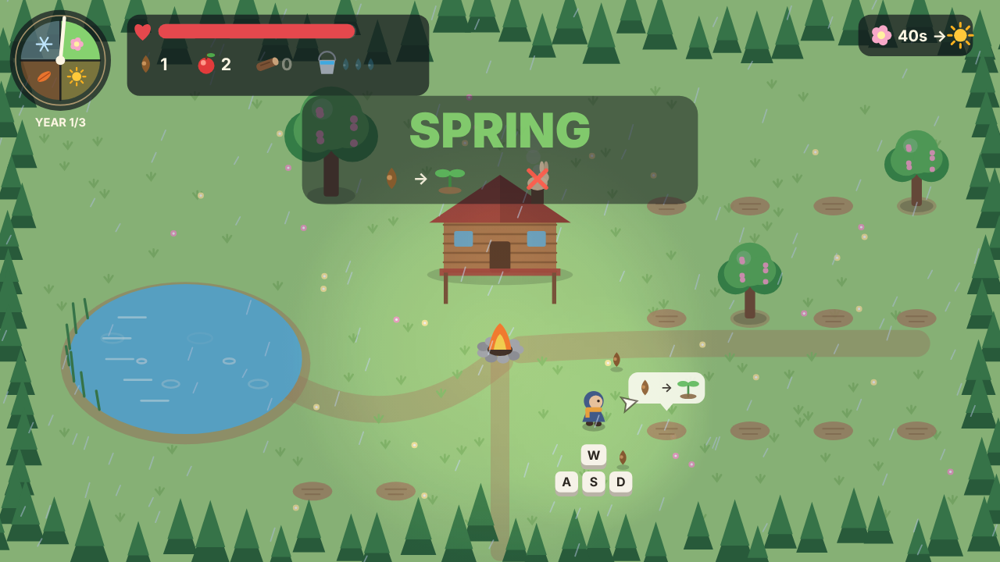 | 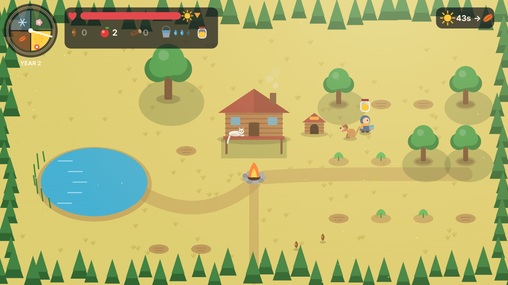 |
| **Spring:** plant seeds; a red **!!** marks a rabbit going for your sprouts | **Summer:** carry water in the heat while the sun jar fills |
| 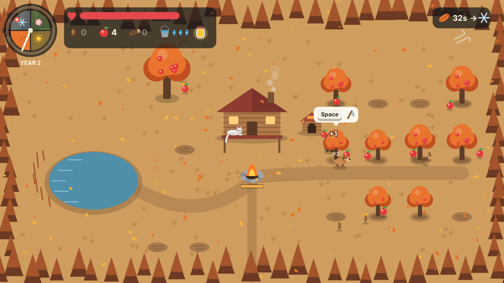 | 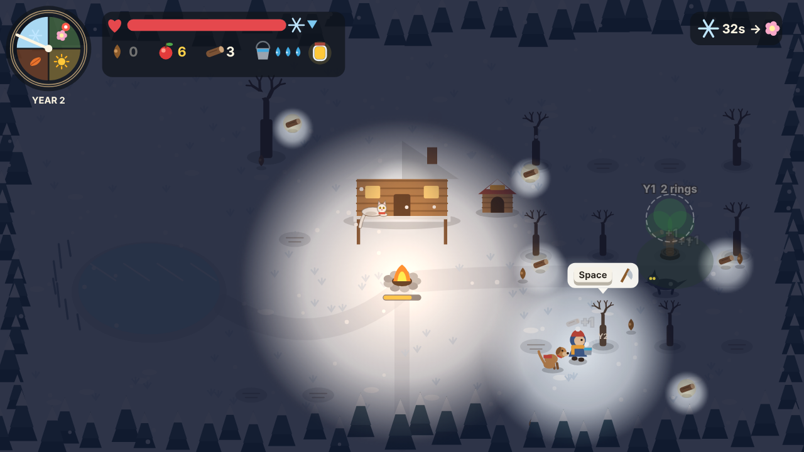 |
| **Fall:** gather fruit and wood; the dog fetches for you | **Winter:** keep the fire alive and venture into the dark for wood |
|  | 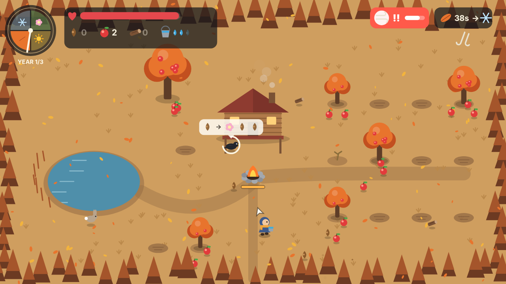 |
| **Wildfire:** one tree and two sprouts at most; one splash puts each out | **Gust:** fruit flies everywhere; fruit blown into the pond sinks |
| 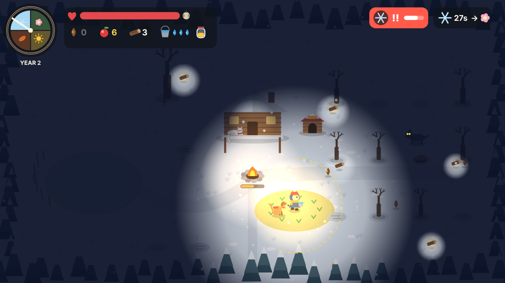 | 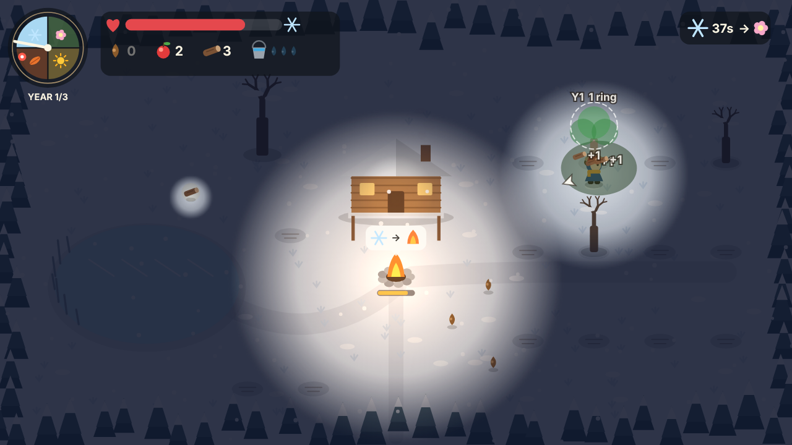 |
| **Blizzard:** the light shrinks and a wolf comes in | **Tree memories:** a felled tree flashes its summer shade, year and rings |
| 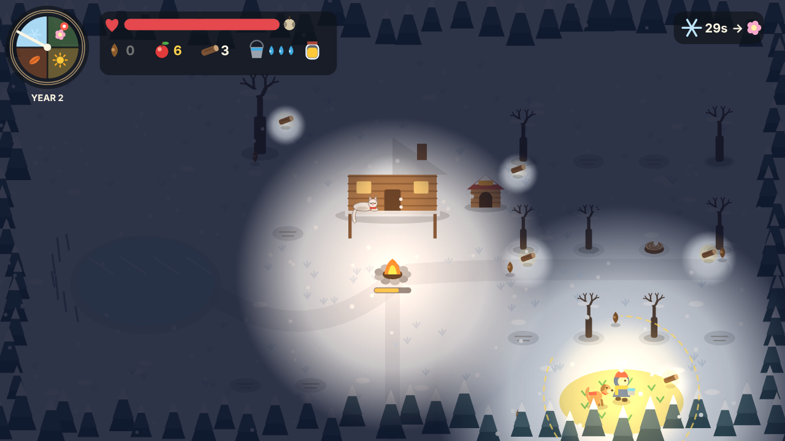 | 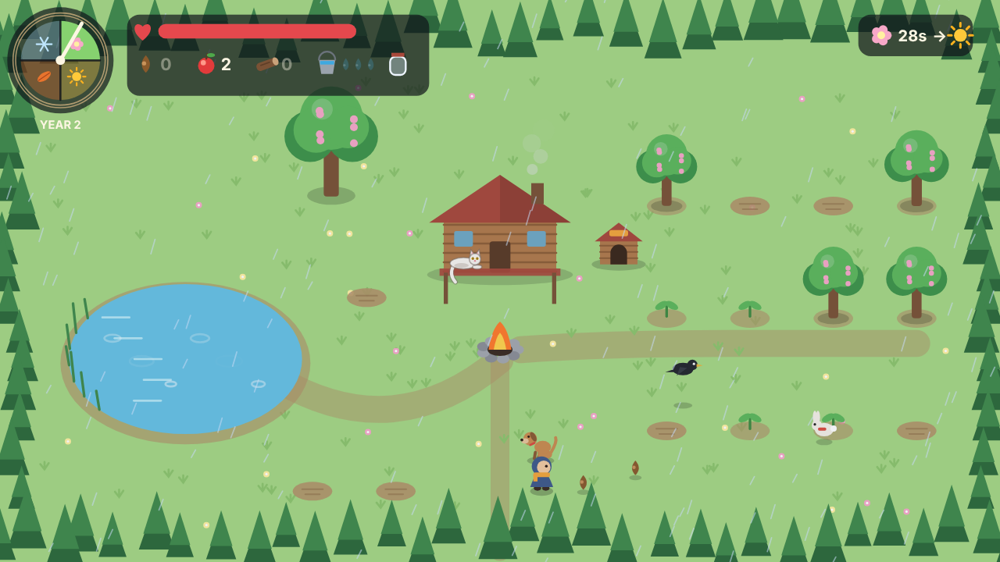 |
| **Sun jar:** a circle of summer in the dark | **Animals remember:** the guard rabbit and the crow's gift of seeds |
| 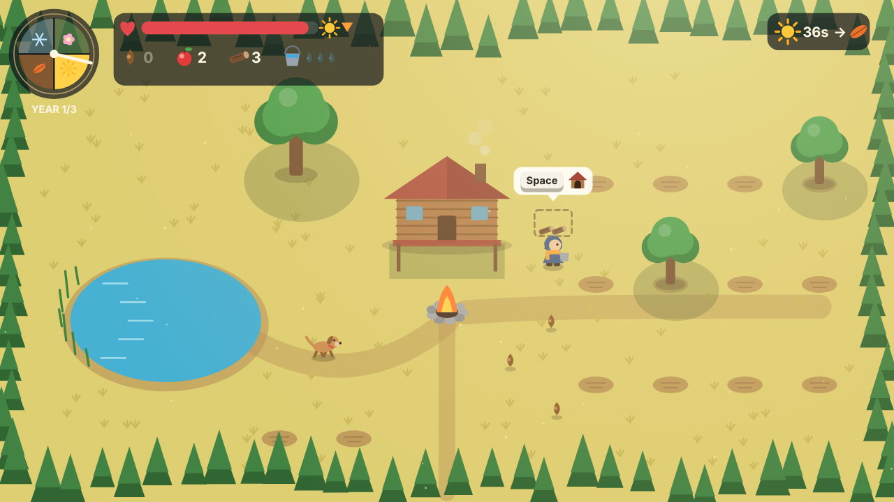 | 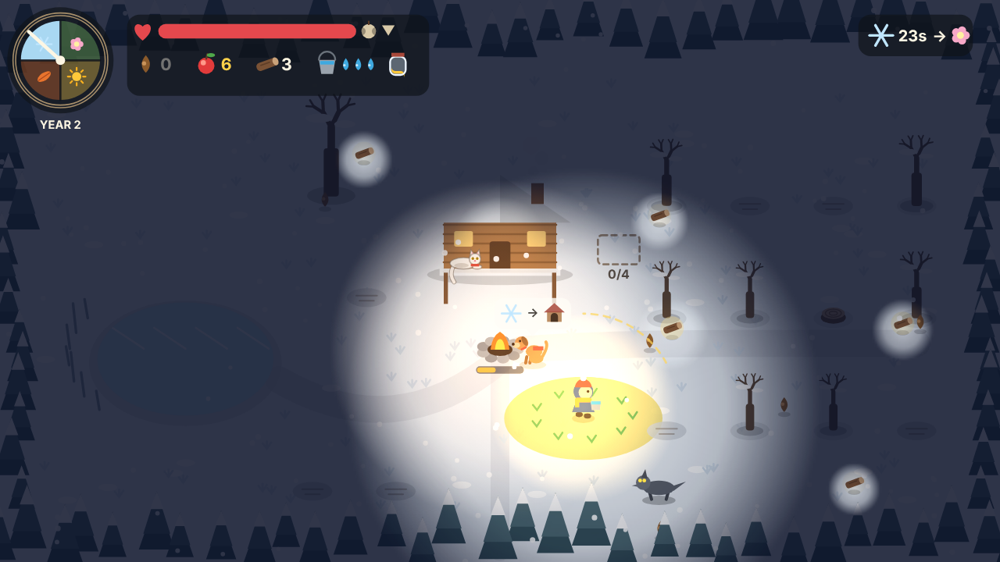 |
| **The dog** helps you all year | **No house?** It shivers by the fire and shows what it needs |
| 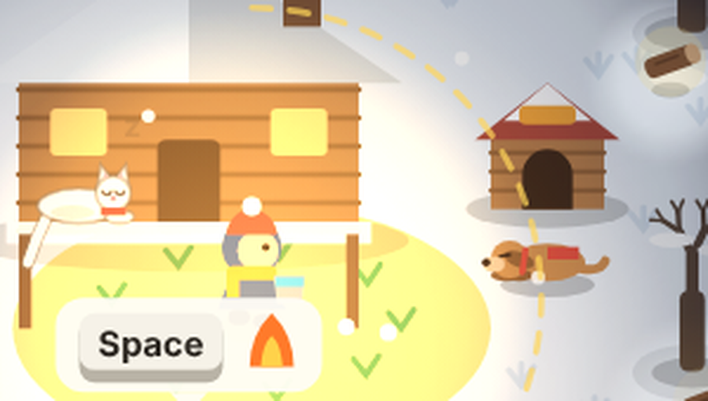 | 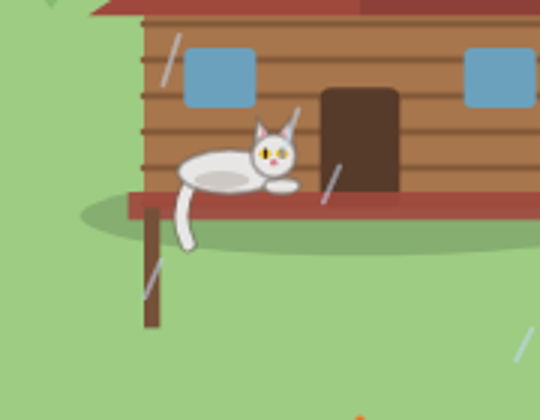 |
| **Home:** the dog naps at its house when you're home | **The porch cat** arrives in year 2 |

## Accessibility (Options menu)

- **Remappable controls** for every action (two keys per action; the second is a fixed alternative).
- **Colour-blind palette** (Okabe-Ito colours; fruit changes from red to outlined orange so it never relies on red versus green, health turns blue).
- **Difficulty:** Gentle, Normal, Hard (season length, heat, cold, hunger, wolves, fruit yield, fire burn).
- **Picture hints:** first year only, always, or off.
- **Reduce motion:** turns off screen shake, bobbing and most particles. It's on by default if the OS asks for reduced motion.
- Separate music and sound effect volume.
- Auto-pauses when the window loses focus.
- Settings are saved in the browser.

## Teaching without text

The first year is the tutorial, and it uses no instruction text:

- Movement keycaps appear under the character until you move.
- Picture bubbles point at the next useful thing (seed, then plot; bucket, then pond; sun, then shade; wood, then fire).
- An arrow by the character points to whatever the bubble is on.
- A context bubble with the act key appears over anything you can use right now. A crossed-out sprout shows that seeds can't be planted out of season.
- Each season opens with a banner of two picture rules, such as `seed → sprout` and `rabbit ✕`.
- The pause screen shows all four seasons as picture rules.

## Art and audio (made during the event)

- **Art:** every shape is drawn in code on an HTML5 canvas in one flat "paper diorama" style. Each season uses the same shapes with its own palette, and colours cross-fade when the season turns.
- **Music:** generated live with the Web Audio API. Each season has its own key, tempo and instrument: plucked major pentatonic for spring, slow lydian pads for summer, dorian reeds for fall, sparse minor bells for winter.
- **Ambience and sound effects:** synthesized from noise and oscillators, including rain, cicadas, wind gusts, a winter howl, chopping, splashing, fire crackle, rabbit squeaks, wolf howls and ice cracks.

## Third-party assets, tools and libraries

**None in the game.** No engine, framework, library, image, sound or font file is used. Text uses the computer's own system font.

Tools used to make it: a text editor, a web browser, and Playwright with headless Chromium for automated playtesting (not part of the game). The game was written with help from Claude, an AI assistant by Anthropic. Check whether the jam rules ask you to declare AI assistance, and say so if they do.

## Files

- `index.html`: the complete game
- `screenshots/`: every season, each weather event, the sun jar, the dog, the cat and the title screen
- `PITCH.md`: a 5-minute pitch script and likely judge questions
- `SUBMISSION.md`: the deliverables checklist mapped to the brief and rubric
